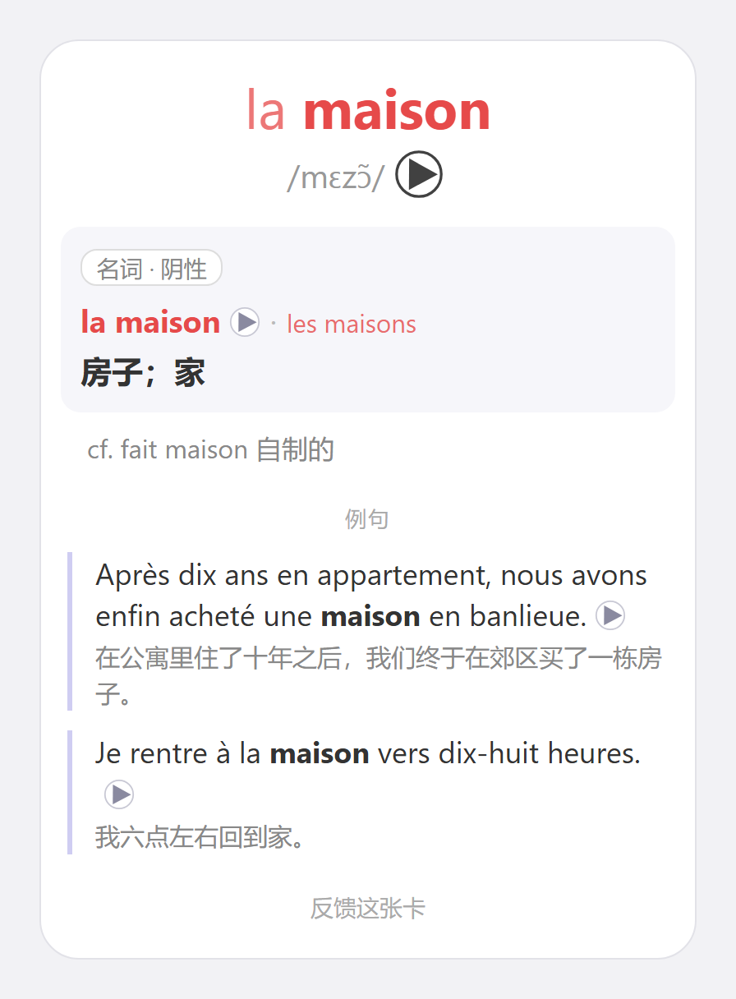
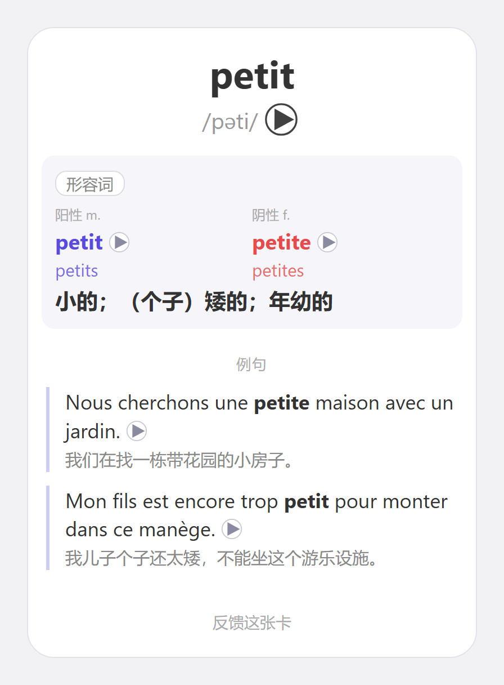

# 你唯一需要的 TCF 法语卡组

虽然标题是TCF,但这其实是一个通用 Anki 法语词汇卡组：包含**6900+常用词（按 A1–C1 分级），每个词都有发音、中文释义和带中文翻译的例句**。
 

[下载](https://github.com/chillibeaver/the-only-french-deck/releases/latest)　·　[反馈](https://github.com/chillibeaver/the-only-french-deck/issues)

## 卡组介绍

### 词汇

1. **收词**：合并以下三个来源，去重后约 7800 个词
   - Wiktionary 的 [OpenSubtitles Top 20K](https://en.wiktionary.org/wiki/Wiktionary:Frequency_lists/French/OpenSubtitles_Top_20K) 法语词频表：把变位、阴阳性、单复数等形式归并为原形后，按词频取前 5000 个
   - CLE 教材中 A1–B2 的单词
   - [FLELex](https://cental.uclouvain.be/cefrlex/flelex/) 分级词表中 A1–B1 的全部词，以及 B2 的常见词
2. **筛词**：删去俚语、粗俗用语和过于口语化的词，以及专有名词、品牌、专业术语、冷僻物件、古雅的文学词等不太可能出现在 TCF 考试中的词，共删去约 900 个
3. **分级**：参考 FLELex 的等级和 [Lexique 3](https://www.lexique.org/) 的词频给每个词定级，分成 A1–C1 五个子卡组：

   | 等级 | A1 | A2 | B1 | B2 | C1 |
   |---|---|---|---|---|---|
   | 词数 | 812 | 1369 | 2210 | 2094 | 463 |

最终组成了目前的 6900+ 词汇。根据各个网站以及自己当年学习英语的经验，6900+ 词汇应付 B2 应该绰绰有余。卡片释义刻意只放了常见释义，如果有遗漏欢迎提 issue。

### 音频

卡组音频全部由 Google 的 Chirp 3 HD 生成，共 1.2 万多个，经过多轮全库校对：每个音频都用 4 个语音识别模型转写，再和卡上的音标逐个比对；读错的按音标强制重新合成，最终由人工试听。

## 下载与导入

1. 安装官方最新版 Anki
2. 到 [Releases 页面](https://github.com/chillibeaver/the-only-french-deck/releases/latest) 下载 `.apkg` 文件，也可以在 [AnkiWeb](https://ankiweb.net/shared/info/1773194732) 上直接下载
3. 在 Anki 里打开它，或者点「文件 → 导入」
4. 想在多台设备上学，就登录 [AnkiWeb](https://ankiweb.net/) 同步。第一次同步要上传几千个发音文件，可能需要一段时间

## 反馈问题

发现发音、释义、例句或者阴阳性数有错, 或希望添加新的高频词汇, 欢迎反馈：

- 直接点击卡片最下方的`反馈这张卡`按钮。
- 或者直接到 [Issues](https://github.com/chillibeaver/the-only-french-deck/issues) 新建。

## 更新卡组

有新版本时，下载新的 `.apkg` 直接导入就行，学习进度不受影响。新版删掉的词不会自动从你的库里消失，删除方法写在每个版本的发布说明里。

## 许可

卡组内容按 [CC BY-NC-SA 4.0](https://creativecommons.org/licenses/by-nc-sa/4.0/deed.zh-hans) 许可发布：可以自由使用、修改和分享，但要注明出处，不得用于商业用途，改编后的版本也要用同样的许可发布。

## 致谢

FLELex 由 UCLouvain CENTAL 制作，按 CC BY-NC-SA 4.0 许可使用。
