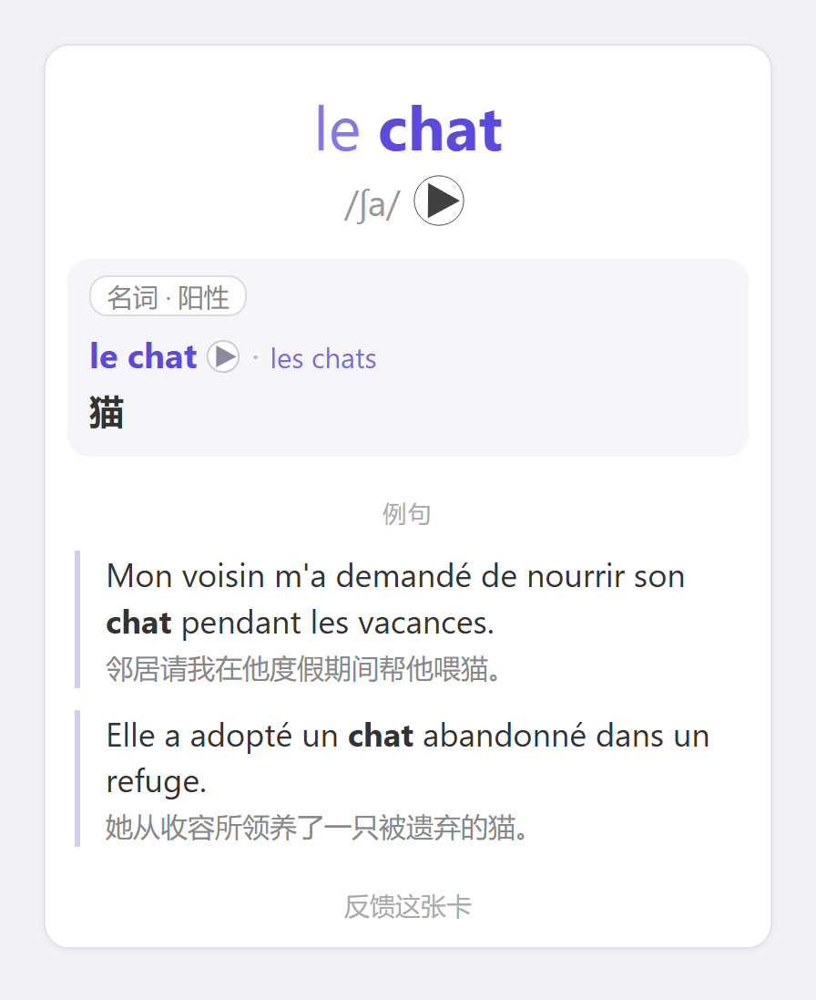
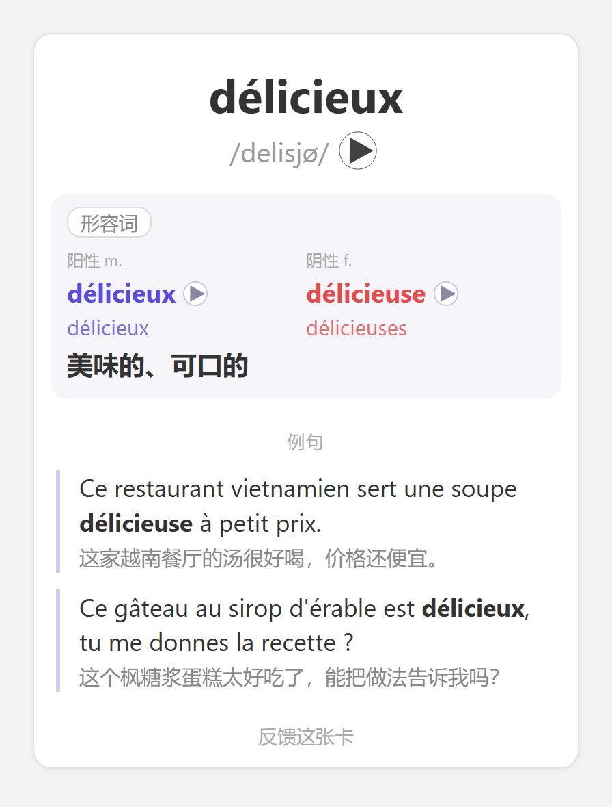

# 你唯一需要的 TCF 法语卡组

虽然标题是TCF,但这其实是一个通用 Anki 法语词汇卡组：包含**6600+常用词，每个词都有发音、中文释义和带中文翻译的例句**。

[下载](https://github.com/chillibeaver/the-only-tcf-deck/releases/latest)　·　[反馈](https://github.com/chillibeaver/the-only-tcf-deck/issues)

## 下载与导入

1. 安装官方最新版 Anki
2. 到 [Releases 页面](https://github.com/chillibeaver/the-only-french-deck/releases/latest) 下载 `.apkg` 文件
3. 在 Anki 里打开它，或者点「文件 → 导入」
4. 想在多台设备上学，就登录 [AnkiWeb](https://ankiweb.net/) 同步。第一次同步要上传几千个发音文件，可能需要一段时间

## 反馈问题

发现发音、释义、例句或者阴阳性数有错, 或希望添加新的高频词汇, 欢迎反馈：

- 直接点击卡片最下方的`反馈这张卡`按钮。
- 或者直接到 [Issues](https://github.com/chillibeaver/the-only-french-deck/issues) 新建。

## 更新卡组

有新版本时，下载新的 `.apkg` 直接导入就行，学习进度不受影响。
